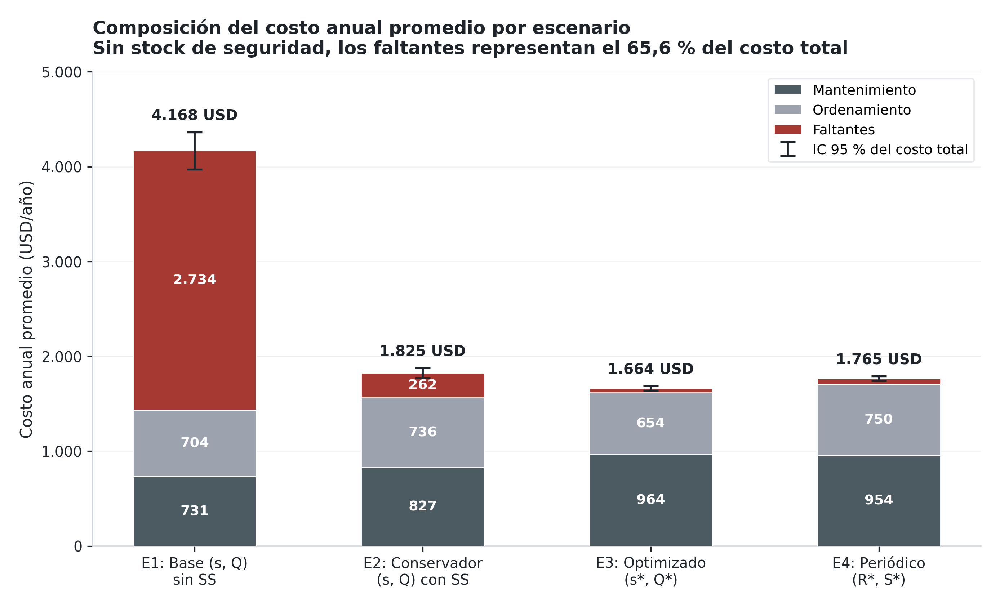

# Simulación y Optimización de Políticas de Inventarios

Proyecto de simulación de eventos discretos y optimización estocástica en Python para definir reglas óptimas de reposición bajo demanda y tiempos de entrega variables con ventas perdidas.

**Autor:** Leandro Joaquín Tabarcache  
**Contexto:** Modelos y Simulación — Facultad de Ingeniería e Informática, Universidad Católica de Salta (UCASAL)

---

## Descripción del problema

Se modela mediante simulación discreta paso a paso (horizonte de 365 días más 60 días de calentamiento) la operación de un centro de distribución mayorista regional (NOA) sobre un SKU de alta rotación (`RT-W6-100`, router Wi-Fi 6 dual-band), con demanda diaria estocástica $D_t \sim \text{Poisson}(\lambda = 8)$ u/día y tiempo de entrega discreto $LT \sim U\{2, 3, 4, 5\}$ días, bajo régimen de **ventas perdidas**.

Se evalúan cuatro políticas empleando **Números Aleatorios Comunes (CRN)** en exploración en dos etapas sobre semilla `2027` (30 réplicas iniciales + 100 réplicas de refinamiento fino) y evaluación confirmatoria independiente sobre semilla `2026` (100 réplicas):

| Escenario | Política | Parámetros | Rol experimental |
| :--- | :--- | :--- | :--- |
| `E1_Base` | Revisión continua $(s, Q)$ | $s = 28,\; Q = 200$ | Línea base EOQ sin stock de seguridad |
| `E2_Conservador` | Revisión continua $(s, Q)$ | $s = 45,\; Q = 200$ | Heurística analítica ($z = 1{,}645$ sobre $D_{LT}$) |
| `E3_Optimizado` | Revisión continua $(s^*, Q^*)$ | $s^* = 53,\; Q^* = 220$ | Óptimo empírico por simulación sujeto a $\text{FR} \geq 95\%$ |
| `E4_Periodico` | Revisión periódica $(R^*, S^*)$ | $R^* = 24,\; S^* = 254$ | Alternativa operativa de revisión fija |

## Resultados principales

- **Reducción de costos:** la política optimizada `(s* = 53, Q* = 220)` reduce el costo anual esperado a **$1.664,24 ± 23,34 USD/año** (**-60,1 %** frente a `E1_Base`, $p = 5{,}10 \times 10^{-45}$; **-8,8 %** frente a `E2_Conservador`, $p = 1{,}37 \times 10^{-7}$).
- **Nivel de servicio:** alcanza un *Fill Rate* del **99,95 %** y un *Cycle Service Level* del **97,00 %** (reduciendo las ventas perdidas de 91,1 a 1,5 unidades/año).
- **Análisis de sensibilidad:** el **74,1 %** de la varianza de la demanda durante la reposición proviene de la dispersión del tiempo de entrega, no de la demanda diaria.



## Estructura del proyecto

```text
simulacion-inventarios/
├── main.py                         # Orquestador del flujo completo (validación, experimentos y gráficos)
├── requirements.txt                # Dependencias analíticas y de testing
├── src/
│   ├── config.py                   # Parámetros, derivaciones EOQ/SS y grillas (etapa 1 y 2)
│   ├── simulator.py                # Motor de eventos discretos, undershoot y generadores CRN
│   ├── validation.py               # Verificación (V1–V6) y validación contra EOQ
│   ├── experiments.py              # Búsqueda en dos etapas, pruebas t/Wilcoxon, CRN y sensibilidad
│   └── plotting.py                 # Generación de 11 figuras de alta resolución (300 DPI)
├── tests/
│   └── test_simulator.py           # Pruebas unitarias pytest (10 casos)
├── notebooks/
│   └── analisis_completo.ipynb     # Notebook reproducible ejecutado
└── results/
    ├── *.csv, optimos.json         # Salidas tabulares, CRN, auditoría y sensibilidad
    └── img/fig01..fig11.png        # Figuras generadas
```

## Ejecución

```bash
pip install -r requirements.txt
pytest tests/ -v
python main.py
```

Para ejecutar módulos individuales:

```bash
python -m src.validation
python -m src.experiments
python -m src.plotting
```
